<div align="center">

# 🔩 HardwareHub IMS

**Inventory, online ordering and point-of-sale for a neighbourhood hardware store.**

Customers browse the catalogue, check out with cash on delivery, GCash or bank transfer, and track their order step by step.
Staff confirm orders, verify payments, ring up walk-in sales, restock from suppliers and see what's selling — all from one app.


[](https://github.com/charlespura/hardware-ims/actions/workflows/tests.yml)


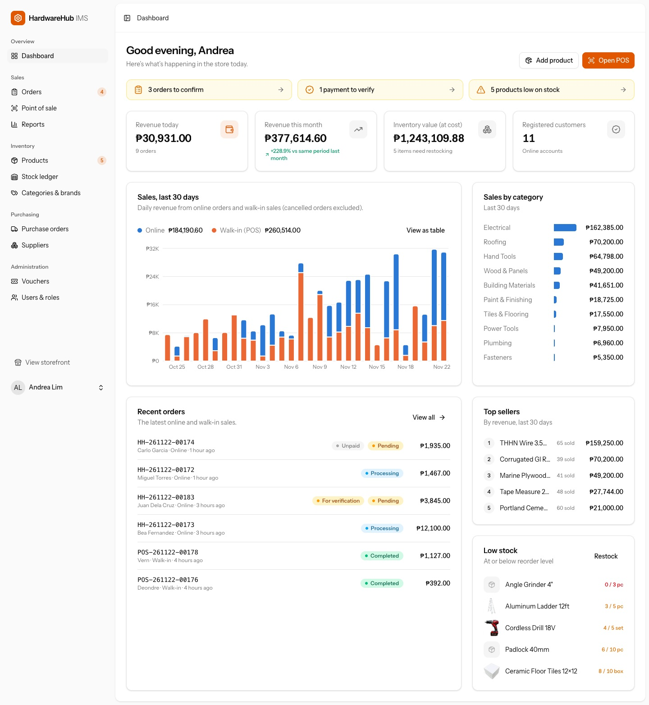

</div>

---

## Contents

- [Features](#features)
- [Screenshots](#screenshots)
- [How the workflow works](#how-the-workflow-works)
- [Roles and permissions](#roles-and-permissions)
- [Tech stack](#tech-stack)
- [Getting started](#getting-started)
- [Demo accounts](#demo-accounts)
- [Configuration](#configuration)
- [Project structure](#project-structure)
- [Data model](#data-model)
- [Testing and code quality](#testing-and-code-quality)
- [What changed from the original PHP version](#what-changed-from-the-original-php-version)
- [Roadmap](#roadmap)
- [License](#license)

---

## Features

### 🛒 Storefront (customers)

- **Catalogue** with search (name, model, SKU), category and brand filters, price range, _in stock only_ toggle, sorting (best selling, price, newest) and pagination — all kept in the URL so results are shareable.
- **Product pages** with photos, specifications, live stock ("Only 3 left") and related items.
- **Cart** that respects stock limits, warns when an item sold out after you added it, and shows how much more you need for free delivery.
- **Vouchers** — percentage, fixed amount or free shipping, with minimum spend, max discount, start/end dates, usage limits and _one use per customer_.
- **Checkout** in clear steps: delivery or store pickup → saved address (or add one on the spot) → preferred date → payment.
- **Payments:** cash on delivery / at pickup, or **GCash / bank transfer** with reference number and receipt upload. Staff verify the proof; if it's rejected the customer is told why and can upload a new one.
- **Order tracking** with a progress stepper, full activity timeline, staff notes, cancel (while still pending), _Buy again_, and a **printable receipt with QR code**.
- **E-mail notifications** when an order is placed, confirmed, shipped / ready, completed, cancelled, or when a payment is verified or rejected.
- Address book, profile, password, **two-factor authentication** and light / dark mode.

### 🧰 Back office (staff and admins)

- **Dashboard** — today's and this month's revenue (with change vs last month), inventory value, a 30-day online-vs-walk-in sales chart, sales by category, top sellers, recent orders, and one-click _to-do_ tiles for orders to confirm, payments to verify and low-stock items.
- **Order queue** with status tabs and counts, search by order number, name, e-mail or phone, and a guided workflow: _Verify payment → Confirm → Out for delivery / Ready for pickup → Completed_. Invalid jumps are blocked.
- **Point of sale** for walk-in customers: tap or **scan a barcode / SKU**, quick-cash buttons, automatic change, GCash reference capture, and an instant receipt.
- **Products** — create and edit with photo upload, cost vs selling price and live margin, reorder level, _show in shop_ and _featured_ switches, archive and restore.
- **Stock ledger** — every change (opening stock, sale, cancellation restock, PO received, manual adjustment) is recorded with who did it and the resulting balance. Stock can only change through the ledger.
- **Purchase orders** — raise POs against suppliers, pull in every low-stock item with suggested quantities in one click, and _receive_ the delivery to add stock and update cost prices.
- **Suppliers**, **categories and brands**.
- **Reports** — net sales, gross profit and margin, COGS, average order value, sales by channel and payment method, and product performance for any date range, plus **CSV exports** of sales and inventory.
- **Vouchers** and **users and roles** (admin only): create staff accounts, change roles, deactivate accounts.

### 🔐 Security and quality

- Role-based access (admin / staff / customer) through route middleware and policies. Customers can only ever see their own orders.
- All input validated with form requests; Eloquent everywhere (no hand-built SQL strings).
- Money stored as `DECIMAL`, stock changes made inside database transactions with row locks, so two checkouts can't oversell the last item.
- CSRF protection, login rate limiting, deactivated-account lockout, optional 2FA.
- **76 automated tests**, PHPStan / Larastan **level 7**, Pint, Vite+ lint and format checks, and strict TypeScript, all run in CI.

---

## Screenshots

|                                                          Storefront                                                           |                                                                 Product                                                                 |
| :---------------------------------------------------------------------------------------------------------------------------: | :-------------------------------------------------------------------------------------------------------------------------------------: |
|    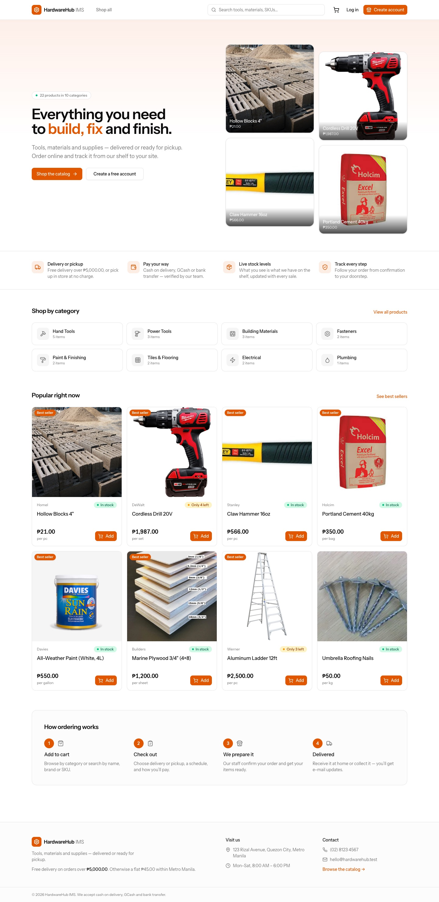    | 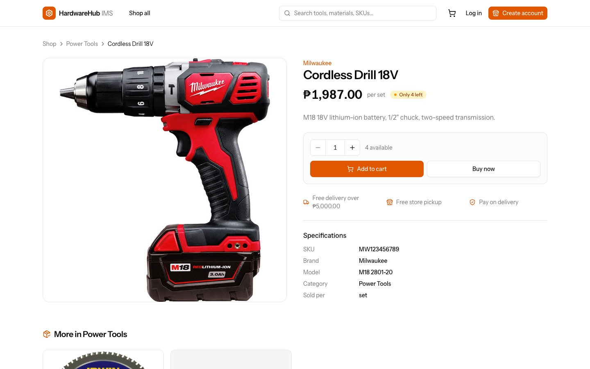 |
|                                                  **Catalogue with filters**                                                   |                                                  **Cart with free-delivery progress**                                                   |
|        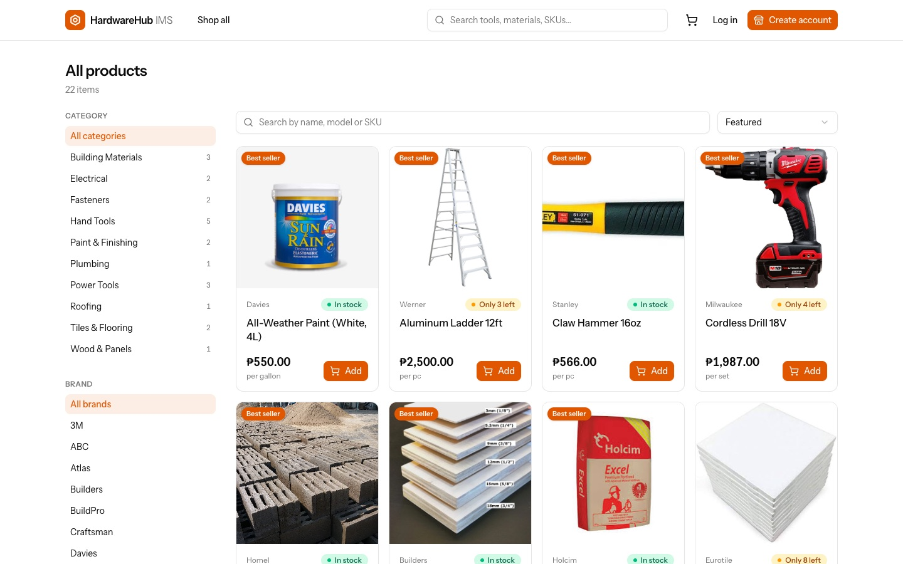        |            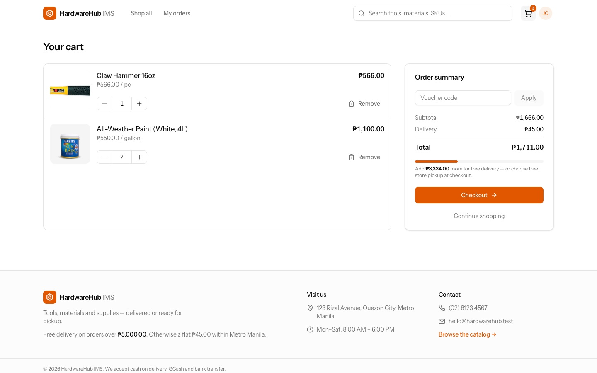            |
|                                                   **Step-by-step checkout**                                                   |                                                           **Order tracking**                                                            |
| 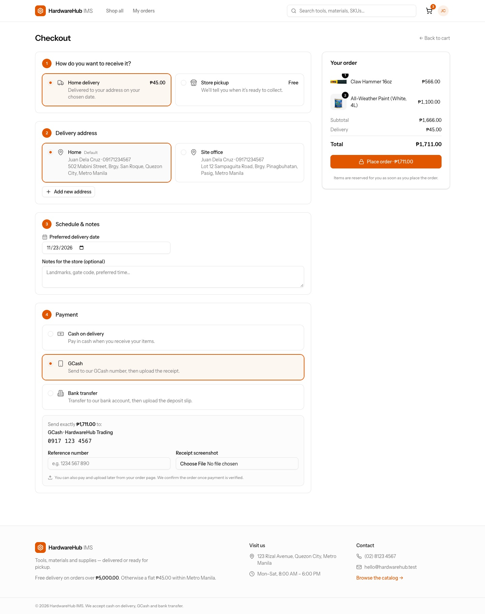 |     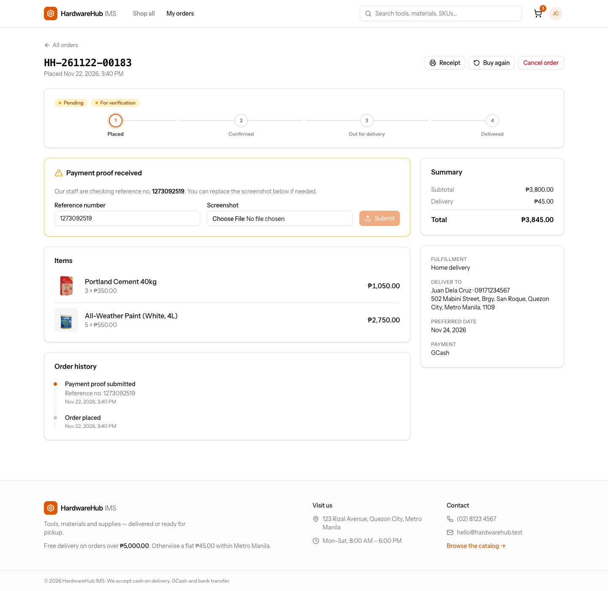      |

|                                                                            Back office                                                                            |                                                                                                                                                                                  |
| :---------------------------------------------------------------------------------------------------------------------------------------------------------------: | :------------------------------------------------------------------------------------------------------------------------------------------------------------------------------: |
|                                                                     **Payment verification**                                                                      |                                                                                **Point of sale**                                                                                 |
| 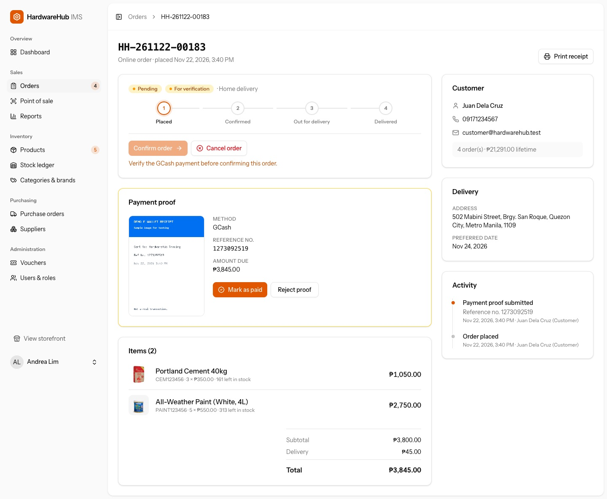 |                        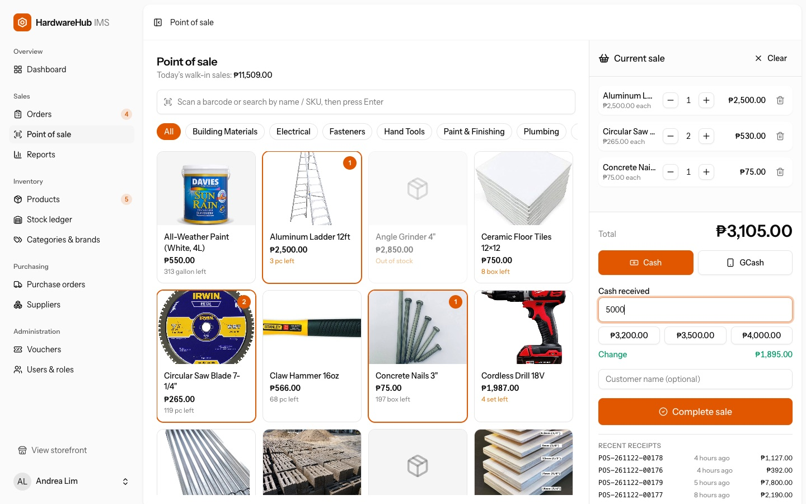                         |
|                                                                          **Order queue**                                                                          |                                                                           **Product and stock ledger**                                                                           |
|                                    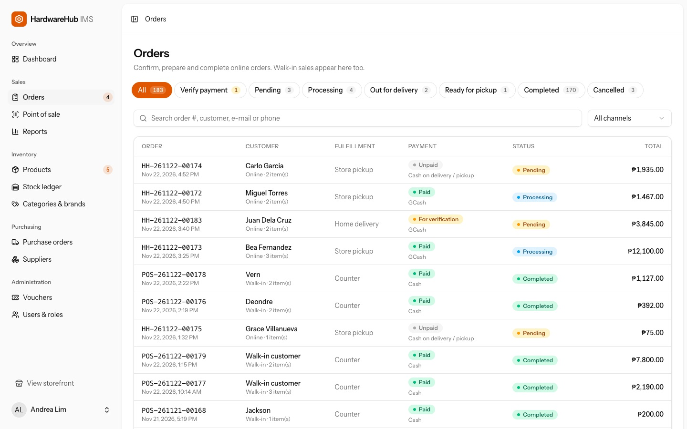                                    |                            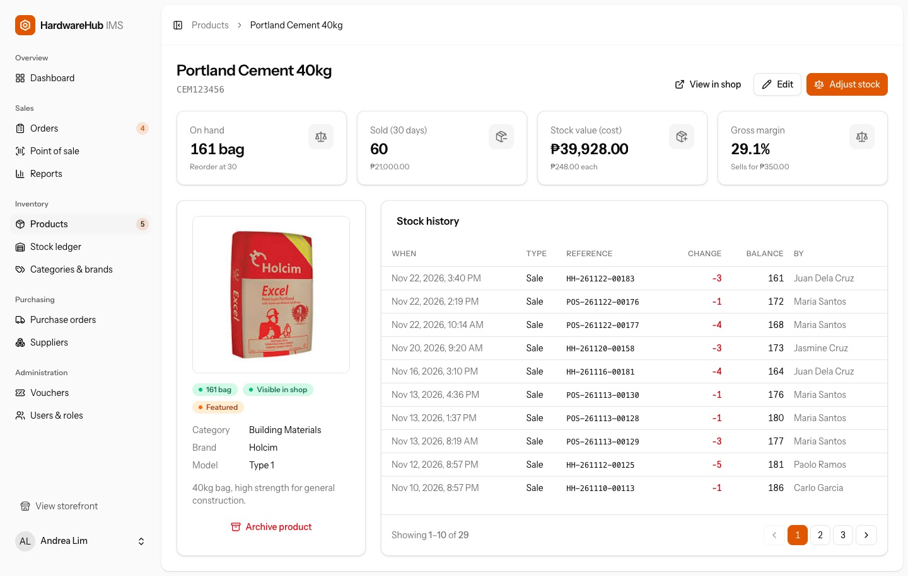                             |
|                                                           **Purchase order with low-stock suggestions**                                                           |                                                                                 **Sales report**                                                                                 |
|                    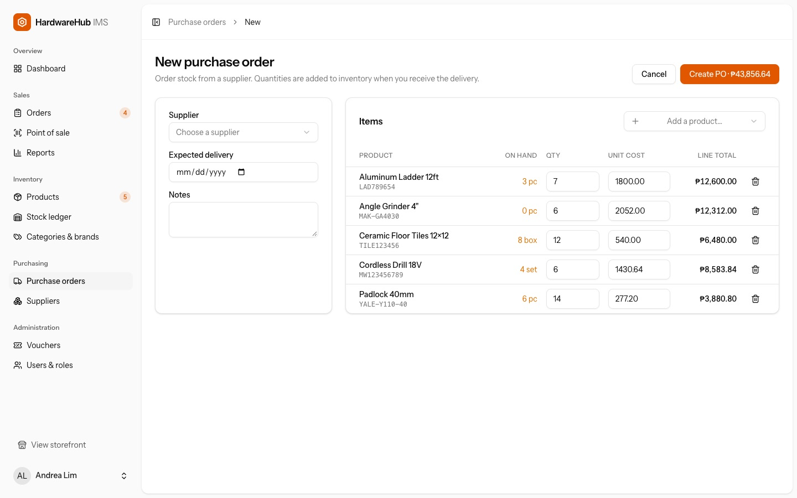                     |                            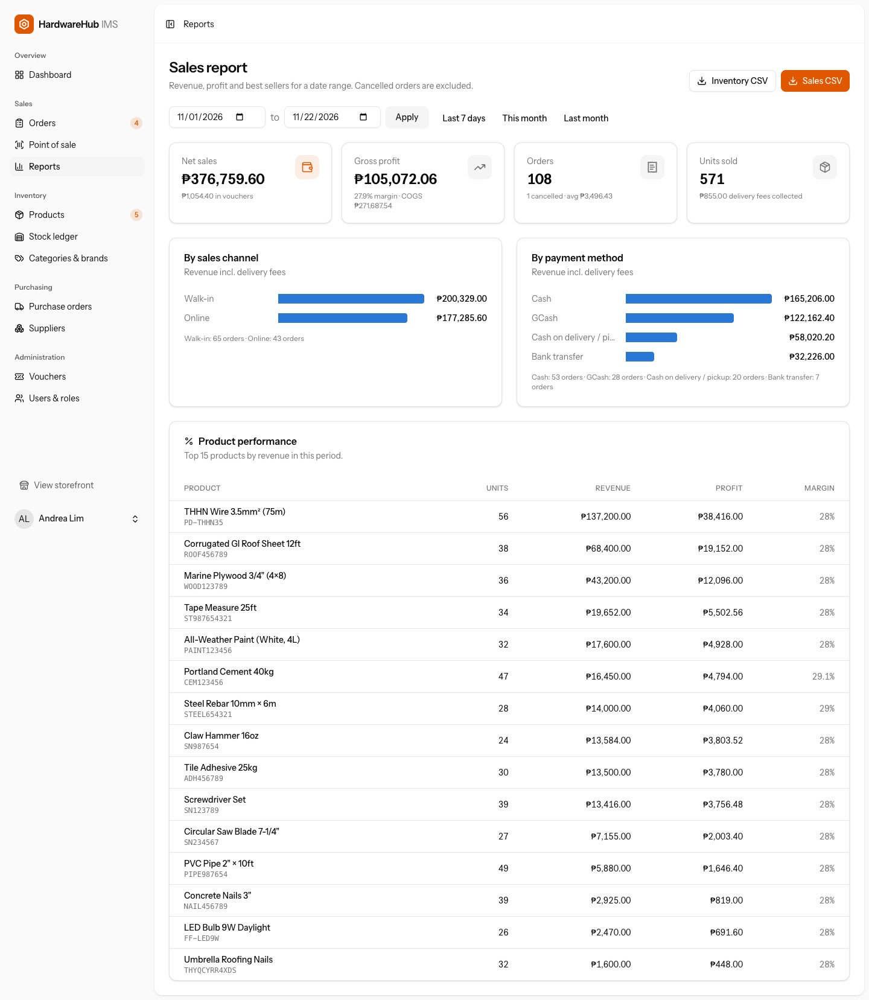                             |
|                                                                           **Dark mode**                                                                           |                                                                                    **Mobile**                                                                                    |
|                                  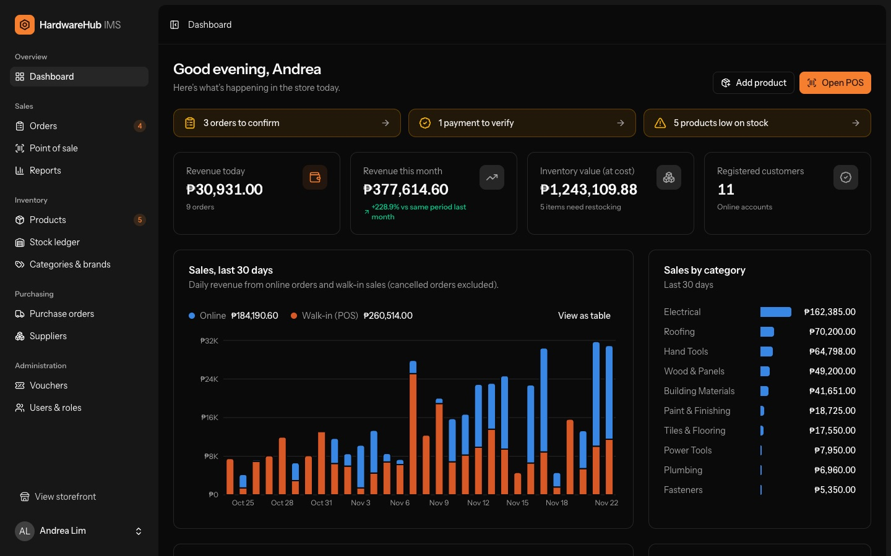                                   | 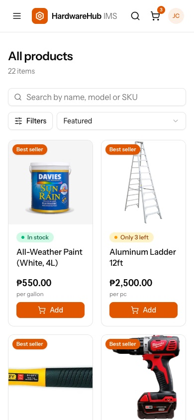 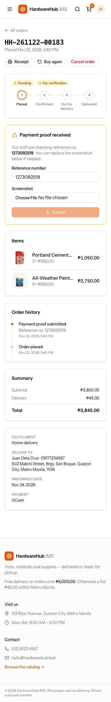 |

---

## How the workflow works

### Order lifecycle

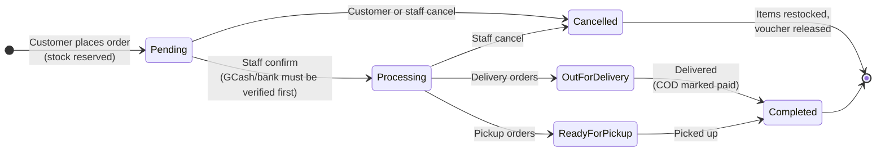

- **Stock is reserved when the order is placed**, not when it ships, so customers can never buy something that's already gone.
- **Cancelling** puts every item back in stock (recorded in the ledger), releases the voucher, and marks money already sent as _Refund due_.
- **Walk-in (POS) sales** go straight to _Completed_ and appear in the same order list and reports.

### Manual payment verification (GCash / bank transfer)

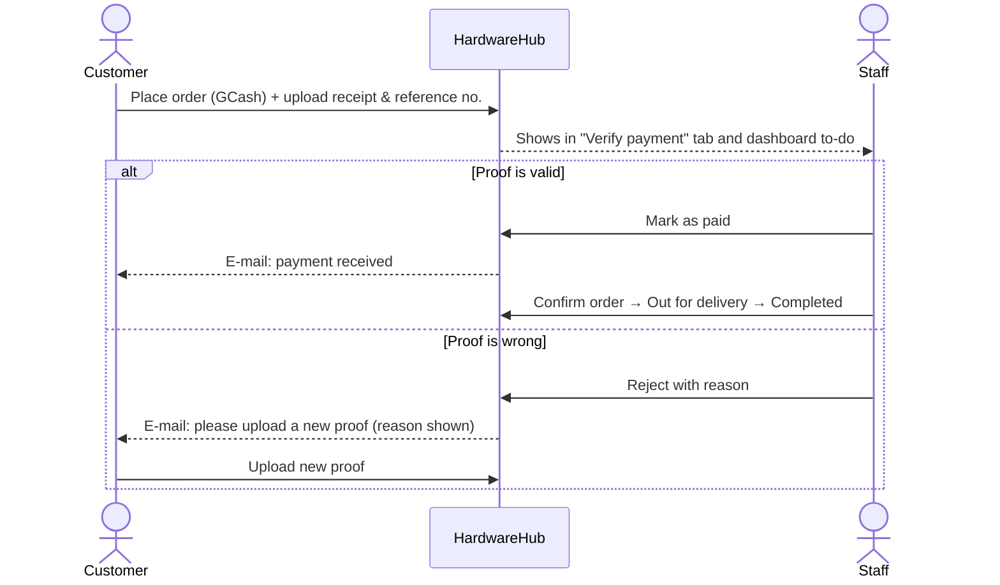

### Restocking

`Low-stock alert` → **New purchase order** (_Add low-stock items_ fills suggested quantities) → supplier delivers → **Receive** → stock goes up, cost prices update, ledger entries are written.

---

## Roles and permissions

| Capability                                      | Customer | Staff | Admin |
| ----------------------------------------------- | :------: | :---: | :---: |
| Browse, cart, checkout, track own orders        |    ✅    |   —   |   —   |
| Dashboard, orders, payment verification         |    —     |  ✅   |  ✅   |
| Point of sale                                   |    —     |  ✅   |  ✅   |
| Products, stock adjustments, categories, brands |    —     |  ✅   |  ✅   |
| Suppliers and purchase orders                   |    —     |  ✅   |  ✅   |
| Reports and CSV exports                         |    —     |  ✅   |  ✅   |
| Vouchers                                        |    —     |   —   |  ✅   |
| Users and roles                                 |    —     |   —   |  ✅   |

New sign-ups are always customers; only an admin can create staff or admin accounts.

---

## Tech stack

| Layer    | Tools                                                                                                         |
| -------- | ------------------------------------------------------------------------------------------------------------- |
| Backend  | **Laravel 13** (PHP 8.4+), Fortify (auth + 2FA), Eloquent, form requests, policies, notifications             |
| Frontend | **React 19** + **TypeScript**, **Inertia.js 3** (no separate API needed), Wayfinder (type-safe route helpers) |
| UI       | **Tailwind CSS 4**, shadcn/ui (Radix primitives), lucide icons, Recharts, `qrcode.react`                      |
| Database | **MySQL / MariaDB** (XAMPP) or SQLite                                                                         |
| Tooling  | Vite+ (build, lint, format), PHPUnit, Larastan level 7, Pint, GitHub Actions                                  |

---

## Getting started

### Requirements

- PHP **8.4+** with `pdo_mysql` (or `pdo_sqlite`), `gd`, `mbstring`, `intl`, `zip`
- Composer 2
- Node.js **22.18+** or **24 LTS**
- MySQL 8 / MariaDB 10.4+ (XAMPP works), **or** SQLite for a zero-setup try-out

### 1. Install

```bash
git clone https://github.com/charlespura/hardware-ims.git
cd hardware-ims

composer install
npm install
cp .env.example .env
php artisan key:generate
```

### 2. Create the database

**MySQL / XAMPP:** start MySQL in the XAMPP control panel and create a database:

```sql
CREATE DATABASE hardware_ims CHARACTER SET utf8mb4 COLLATE utf8mb4_unicode_ci;
```

Check the connection settings in `.env`. XAMPP's defaults are user `root` with no password. If your MySQL runs on a different port (e.g. **3307**), change `DB_PORT`.

```dotenv
DB_CONNECTION=mysql
DB_HOST=127.0.0.1
DB_PORT=3306
DB_DATABASE=hardware_ims
DB_USERNAME=root
DB_PASSWORD=
```

**SQLite instead:** set `DB_CONNECTION=sqlite`, delete the other `DB_*` lines, and run `touch database/database.sqlite`.

### 3. Load the demo store

```bash
composer demo   # links storage, migrates and seeds the demo data
```

This creates 22 products (including the 18 products and photos from the original version, cleaned up), 10 categories, 3 suppliers, 4 vouchers, demo accounts and **about six weeks of realistic order history**. The history is generated through the real order service, so every chart, ledger entry and timeline is consistent.

### 4. Run it

```bash
composer run dev
```

Open **http://localhost:8000**. This starts the Laravel server, the queue worker, the log viewer and Vite with hot reload together. For a quick run without Vite, use `npm run build` then `php artisan serve`.

> **Using XAMPP's Apache?** Don't browse to `http://localhost/hardware-ims`: the project root isn't a web root, and a root `.htaccess` blocks it on purpose so `.env` can't be downloaded. Either use `composer run dev`, or create a virtual host whose `DocumentRoot` is the `public/` folder.

### E-mail

`MAIL_MAILER=log` writes every e-mail to `storage/logs/laravel.log`, so you can see the order notifications without an SMTP server. To send real mail, set the `MAIL_*` variables (Mailtrap, Gmail app password, etc.). **Never commit credentials**: they belong in `.env`, which is git-ignored.

---

## Demo accounts

All passwords are **`password`**.

| Role     | E-mail                      | Try this                                                                                                   |
| -------- | --------------------------- | ---------------------------------------------------------------------------------------------------------- |
| Admin    | `admin@hardwarehub.test`    | Dashboard, vouchers, users and roles, reports                                                              |
| Staff    | `staff@hardwarehub.test`    | Verify the pending GCash payments, run a POS sale, receive a PO                                            |
| Customer | `customer@hardwarehub.test` | Has items in the cart and orders at different stages (delivered, out for delivery, awaiting payment check) |

Vouchers to try at checkout: `WELCOME10` (10% off ₱500+), `LESS100` (₱100 off ₱1,500+), `FREESHIP`, and `BUILD2025` (expired, to see the error message).

---

## Configuration

Store details and business rules live in [`config/store.php`](config/store.php) and can be overridden from `.env`:

| Variable                                                                    | Default           | Purpose                                                 |
| --------------------------------------------------------------------------- | ----------------- | ------------------------------------------------------- |
| `APP_NAME`                                                                  | `HardwareHub IMS` | Store name shown everywhere                             |
| `STORE_SHIPPING_FEE`                                                        | `45`              | Flat delivery fee (₱)                                   |
| `STORE_FREE_SHIPPING_THRESHOLD`                                             | `5000`            | Subtotal that makes delivery free                       |
| `STORE_MAX_SCHEDULE_DAYS`                                                   | `30`              | How far ahead customers can schedule delivery or pickup |
| `STORE_GCASH_NAME` / `STORE_GCASH_NUMBER`                                   | —                 | GCash account shown at checkout                         |
| `STORE_BANK_NAME` / `STORE_BANK_ACCOUNT_NAME` / `STORE_BANK_ACCOUNT_NUMBER` | —                 | Bank account shown at checkout                          |
| `STORE_ADDRESS`, `STORE_PHONE`, `STORE_EMAIL`, `STORE_HOURS`                | —                 | Footer, receipts and e-mails                            |
| `APP_TIMEZONE`                                                              | `Asia/Manila`     | Dates on orders and reports                             |

---

## Project structure

```text
app/
├── Enums/                 Role, OrderStatus (with allowed transitions), PaymentStatus, StockMovementType …
├── Http/
│   ├── Controllers/Shop/  Storefront: catalogue, cart, checkout, customer orders, addresses
│   ├── Controllers/Admin/ Back office: dashboard, orders, POS, products, inventory, POs, reports …
│   ├── Middleware/        EnsureUserHasRole (`role:admin,staff`), shared Inertia props
│   └── Requests/          Validation for checkout, products, vouchers, POS sales, POs
├── Models/                Product, Order, OrderItem, OrderActivity, StockMovement, Voucher, Supplier …
├── Notifications/         Order placed / updated e-mails
├── Policies/              OrderPolicy (view, cancel, upload payment proof)
└── Services/              The business rules, kept out of controllers:
    ├── InventoryService      every stock change + ledger entry (row-locked)
    ├── PricingService        subtotal, delivery fee, voucher rules (one source of truth)
    ├── OrderService          place online / POS orders, status transitions, cancel, payments
    └── PurchaseOrderService  create, receive, cancel purchase orders
database/
├── migrations/            Schema
├── seeders/               Demo store + images/ (legacy product photos)
resources/js/
├── pages/                 One React page per screen (shop/, cart/, checkout/, orders/, admin/ …)
├── components/            Shared UI (status badges, charts, order timeline, POS, shadcn/ui)
├── layouts/               Storefront layout, back-office sidebar layout, settings layout
└── lib/                   Formatting (₱, dates) and status labels
routes/
├── web.php                Storefront + customer routes
├── admin.php              Back-office routes (role-protected)
└── settings.php           Profile, security, appearance
tests/Feature/Store/       Cart, checkout, order workflow, authorization, POS, purchasing, reports
```

---

## Data model

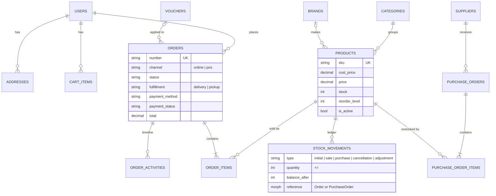

Order items keep a **snapshot** of the product name, SKU, price and cost at the time of sale, so reports and receipts stay correct even after a product is renamed, repriced or archived.

---

## Testing and code quality

```bash
php artisan test        # 76 tests: cart, checkout, vouchers, workflow, auth, POS, purchasing …
composer test           # Pint (style) + Larastan level 7 + the test suite
npm run check           # frontend lint + formatting
npm run types:check     # TypeScript
composer ci:check       # everything CI runs
```

Tests run on in-memory SQLite and don't touch your MySQL data. GitHub Actions runs the full `ci:check` on every push and pull request (see `.github/workflows/tests.yml`).

A few of the rules the tests guarantee:

- You can't add more to your cart than is in stock, and checkout fails cleanly if stock ran out in the meantime.
- Checkout records every item, deducts stock, writes ledger entries, clears the cart and sends the confirmation e-mail.
- Vouchers are validated (expiry, minimum spend, usage limit, once per customer), and their discount is saved on the order.
- GCash / bank orders can't be confirmed before payment is verified, and order steps can't be skipped.
- Cancelling restocks items and releases the voucher.
- Customers can't see other people's orders or open the back office; staff can't manage users or vouchers; deactivated users can't sign in.
- POS computes change and rejects short payments; receiving a PO adds stock exactly once.

---

## What changed from the original PHP version

This project is a full rewrite of a plain-PHP / Bootstrap store built on XAMPP.

| Area         | Before                                                                                                                                                     | After                                                                                                   |
| ------------ | ---------------------------------------------------------------------------------------------------------------------------------------------------------- | ------------------------------------------------------------------------------------------------------- |
| Architecture | ~40 PHP files mixing SQL, HTML and JS; six Bootstrap versions loaded on one page                                                                           | Laravel MVC + service layer, React + TypeScript pages, one design system                                |
| Security     | SQL built from strings in places; admin pages without access checks; any order readable by changing `?user_id=`; e-mail and SMS credentials in source code | Validated input + Eloquent, role middleware and policies, secrets only in `.env`, rate limiting, 2FA    |
| Orders       | Only the total was saved; no line items; no status                                                                                                         | Line items with price snapshots, a six-state workflow with history and e-mail updates                   |
| Stock        | Never decreased after a sale                                                                                                                               | Reserved at checkout, restocked on cancel, every change in an audited ledger                            |
| Vouchers     | Any text gave 10% off; the voucher table wasn't used                                                                                                       | Real voucher engine (percent, fixed, free shipping, limits, dates, one per customer)                    |
| Money        | Totals saved as integers (centavos lost)                                                                                                                   | `DECIMAL(12,2)` everywhere                                                                              |
| Cart         | Removing an item removed it from **every** customer's cart                                                                                                 | Per-user cart with stock checks                                                                         |
| Payments     | Payment method was just a label                                                                                                                            | COD, plus GCash / bank transfer with receipt upload and staff verification                              |
| Back office  | Product table and user list                                                                                                                                | Dashboard, order queue, POS, stock ledger, purchasing, suppliers, reports and CSV, vouchers, user roles |
| Quality      | No tests                                                                                                                                                   | 76 automated tests, static analysis, linting, CI                                                        |

---

## Roadmap

Ideas for future versions:

- [ ] SMS order updates (e.g. Semaphore or Infobip) as a second notification channel
- [ ] Online payments through PayMongo (GCash, cards) alongside manual verification
- [ ] Printable barcode / price labels for products
- [ ] Partial receiving and supplier returns on purchase orders
- [ ] Multiple branches / warehouses with stock transfers
- [ ] Product variants (sizes, colours)

---

## License

Released under the [MIT License](LICENSE).
